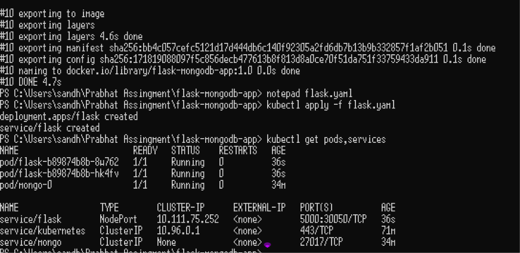
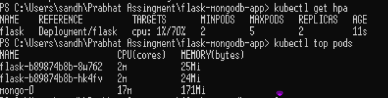
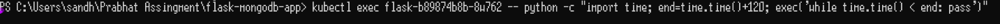
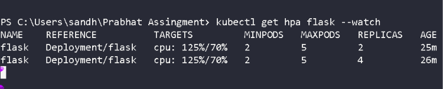

# Flask and MongoDB on Minikube

A learning project that deploys a Python Flask API and an authenticated MongoDB database on a local Kubernetes cluster using Minikube.

## Problem and solution

The assignment asks for a Flask application that stores and retrieves JSON documents in MongoDB, with Kubernetes providing service discovery, persistent storage, resource controls, and autoscaling.

This project packages Flask as a Docker image and runs it in Kubernetes with at least two replicas. MongoDB runs in an authenticated StatefulSet with persistent storage. Kubernetes Services connect Flask to MongoDB and make the API accessible from the local computer.

## Architecture

```text
Postman or browser
        │ HTTP :5000
        ▼
Flask Service
        ├── Flask pod 1
        ├── Flask pod 2
        └── HPA can scale up to 5 pods
                 │
                 │ MongoDB URI uses host "mongo"
                 ▼
       Internal MongoDB Service
                 │
                 ▼
       MongoDB StatefulSet pod
                 │
                 ▼
         Persistent volume
```

## Project files

```text
flask-mongodb-app/
├── app.py
├── requirements.txt
├── Dockerfile
├── flask.yaml
├── mongo.yaml
├── hpa.yaml
├── README.md
└── screenshots/
```

- `app.py` defines the Flask routes and MongoDB connection.
- `Dockerfile` packages the Flask app and Python dependencies.
- `requirements.txt` lists the Python packages.
- `flask.yaml` defines the Flask Deployment and Service.
- `mongo.yaml` defines the MongoDB Service and StatefulSet with persistent storage.
- `hpa.yaml` defines CPU based autoscaling for Flask.

## Prerequisites

Install and start Docker Desktop. You also need Python 3.8 or later, Docker, kubectl, and Minikube.

Commands below are for **PowerShell**.

## Build the Docker image

### Build directly into Minikube

This is the method used for the local deployment:

```powershell
minikube image build -t flask-mongodb-app:1.0 .
```

The local `flask.yaml` uses this image with `imagePullPolicy: Never`.

### Build and push to Docker Hub

Replace the value below with your Docker Hub username:

```powershell
$dockerHubUser = "YOUR_DOCKERHUB_USERNAME"
docker login --username $dockerHubUser
docker build -t "$dockerHubUser/flask-mongodb-app:1.0" .
docker push "$dockerHubUser/flask-mongodb-app:1.0"
```

Before deploying the registry image, update `flask.yaml`:

1. Change the image to `YOUR_DOCKERHUB_USERNAME/flask-mongodb-app:1.0`.
2. Change `imagePullPolicy: Never` to `imagePullPolicy: IfNotPresent`.

Do not put Docker Hub passwords or access tokens in this repository.

## Deploy on Minikube

Start the cluster and check that its node is ready:

```powershell
minikube start --driver=docker
kubectl get nodes
```

Enable CPU metrics for the HPA:

```powershell
minikube addons enable metrics-server
```

### Create MongoDB credentials

Create the Kubernetes Secret. The password is entered securely in PowerShell:

```powershell
$mongoPassword = Read-Host "Enter a local MongoDB password" -AsSecureString
$plainPassword = [System.Net.NetworkCredential]::new("", $mongoPassword).Password
kubectl create secret generic mongo-auth --from-literal=username=flaskuser --from-literal="password=$plainPassword"
Remove-Variable mongoPassword, plainPassword
```

The MongoDB setup uses its initial root account for this local learning project. A production application should use a restricted database user and managed secrets. Never commit real credentials.

### Start MongoDB

```powershell
kubectl apply -f mongo.yaml
kubectl rollout status statefulset/mongo --timeout=180s
kubectl get pods,pvc,pv
```

Wait for `mongo-0` to show `Running` and its PVC to show `Bound`. The PVC requests 1 GiB. Minikube’s `standard` StorageClass dynamically provisions the PV, so this project does not include a separate static PV manifest.

### Start Flask and the HPA

```powershell
kubectl apply -f flask.yaml
kubectl rollout status deployment/flask --timeout=180s
kubectl apply -f hpa.yaml
kubectl get pods,services,hpa
```

The Flask Deployment starts with two replicas. The HPA keeps between two and five replicas and targets average CPU usage of 70%.



### Access the API locally

Forward local port 5000 to the Flask Service:

```powershell
kubectl port-forward service/flask 5000:5000
```

Keep this PowerShell window open while testing. Open `http://localhost:5000` in a browser, or send requests through Postman. Press **Ctrl+C** to stop the port-forward.

## API and code overview

- `GET /` returns a welcome message with the current time.
- `POST /data` accepts a JSON document and inserts it into the MongoDB `flask_db.data` collection.
- `GET /data` retrieves the documents in that collection without MongoDB’s `_id` field.

The app reads its MongoDB connection string from `MONGODB_URI`. Kubernetes provides a URI that uses the internal MongoDB Service name and credentials from the Secret.

Test the API from another PowerShell window while the port-forward is running:

```powershell
Invoke-RestMethod -Uri "http://localhost:5000/" -Method Get
Invoke-RestMethod -Uri "http://localhost:5000/data" -Method Post -ContentType "application/json" -Body '{"sampleKey":"sampleValue"}'
Invoke-RestMethod -Uri "http://localhost:5000/data" -Method Get
```

The final GET response should include the document submitted by the POST request.

## Kubernetes DNS resolution

Kubernetes DNS provides a name for each Service. Since Flask and MongoDB are in the same namespace, Flask can connect to MongoDB using the short name:

```text
mongo
```

The full Service DNS name is `mongo.default.svc.cluster.local`. The MongoDB Service is headless and associated with the StatefulSet, giving the database pod a stable DNS identity. Flask uses `mongo` as its database host; it does not use `localhost`, which would point back to the Flask pod. MongoDB is only reachable from inside the cluster.

## Resource requests, limits, and autoscaling

Both Flask and MongoDB containers use these resource settings:

```yaml
requests:
  cpu: "200m"
  memory: "250Mi"
limits:
  cpu: "500m"
  memory: "500Mi"
```

Requests help Kubernetes decide where to schedule a pod and provide the baseline for HPA CPU utilization. Limits cap the CPU and memory a container can use.

The HPA targets 70% of Flask’s requested CPU. With a request of `200m`, that target is about `140m` CPU per pod.

### HPA baseline

The HPA initially showed two replicas with CPU below the target:



### Autoscaling test

A two-minute CPU-bound process was run inside a Flask pod to raise measured CPU usage:

```powershell
$pod = kubectl get pods -l app=flask -o jsonpath='{.items[0].metadata.name}'
kubectl exec $pod -- python -c "import time; end=time.time()+120; exec('while time.time() < end: pass')"
```

In another PowerShell window, watch the HPA and pods:

```powershell
kubectl get hpa flask --watch
kubectl get pods -l app=flask --watch
```

The HPA target was exceeded and Flask scaled from **2 to 4 replicas**. This verified CPU based autoscaling; it was not a benchmark of HTTP request throughput.





After the load stops, the HPA may take several minutes to scale back down to two replicas.

## Design choices and alternatives

- **Minikube** provides a local Kubernetes cluster without requiring a cloud account.
- **Docker** packages the Flask application and its dependencies. Building into Minikube is convenient locally; pushing to a registry lets other clusters download the image.
- **A StatefulSet** is used for MongoDB because databases need stable identity and persistent storage. Flask is stateless, so it runs as a Deployment.
- **The internal headless MongoDB Service** provides cluster DNS without exposing the database outside Kubernetes.
- **A PVC template and Minikube StorageClass** dynamically create persistent storage instead of requiring a manually defined static PV.
- **The HPA** scales Flask based on CPU. MongoDB remains at one replica in this learning setup.

## Edge cases and troubleshooting

- On first startup, MongoDB may show `ContainerCreating` while Minikube downloads the image and provisions the PVC. Check `kubectl describe pod mongo-0` and `kubectl get pvc`; wait for the pod to become `Running` and the claim to become `Bound`.
- Minikube initially failed on Windows while setting file permissions. Starting PowerShell as Administrator, deleting the incomplete Minikube cluster, and starting it again resolved the issue. `minikube delete` removes the cluster and its workloads.
- Notepad can save the Dockerfile as `Dockerfile.txt`. Docker requires the filename to be exactly `Dockerfile`.
- MongoDB’s initial credentials are applied when its data directory is first initialized. Changing the Kubernetes Secret later does not automatically change the user in an already initialized database.
- This learning app expects valid JSON for `POST /data`; it does not provide custom validation or detailed error responses for malformed JSON or database connection failures.
- The MongoDB root account is for this local assignment only. Use a least-privilege application account in a real deployment.

## Stop Minikube

Stop the local cluster when finished:

```powershell
minikube stop
```

MongoDB data is stored on the PVC. Deleting the Minikube cluster or PVC can remove that data.

<!-- # Flask and MongoDB on Minikube

A learning project that deploys a Python Flask API and an authenticated MongoDB database on a local Kubernetes cluster using Minikube.

## Problem and solution

The assignment asks for a Flask application that stores and retrieves JSON documents in MongoDB, with Kubernetes providing service discovery, persistent database storage, resource controls, and CPU based autoscaling.

This project packages Flask in a Docker image and deploys it with two or more replicas. MongoDB runs in a StatefulSet with authentication enabled and persistent storage. Kubernetes Services connect the application to the database and make the API available locally.

## Architecture

```text
Postman or browser
        │
        │ HTTP :5000
        ▼
Flask Service
        │
        ├── Flask pod 1
        ├── Flask pod 2
        └── HPA can scale up to 5 pods
                 │
                 │ MongoDB URI uses host "mongo"
                 ▼
       Internal MongoDB Service
                 │
                 ▼
       MongoDB StatefulSet pod
                 │
                 ▼
         Persistent volume
```

Flask runs in Kubernetes pods. The MongoDB Service is internal to the cluster; the Flask Service exposes the API. The MongoDB username and password are supplied to the pods through a Kubernetes Secret.

## Project files

```text
flask-mongodb-app/
├── app.py
├── requirements.txt
├── Dockerfile
├── flask.yaml
├── mongo.yaml
├── hpa.yaml
└── .gitignore
```

- `app.py` defines the Flask routes and connects to MongoDB using `MONGODB_URI`.
- `Dockerfile` packages the Flask app and its Python dependencies.
- `requirements.txt` lists the Python packages.
- `flask.yaml` defines the Flask Deployment and Service.
- `mongo.yaml` defines the MongoDB Service and StatefulSet, including its persistent volume claim template.
- `hpa.yaml` defines CPU based autoscaling for Flask.
- `.gitignore` excludes local-only files such as `.env` and `venv`.

## Prerequisites

Install and start Docker Desktop, then install:

- Python 3.8 or later and pip
- Docker
- kubectl
- Minikube

The commands below use **PowerShell**.

## Build the Flask image

### Option A: Build directly into Minikube

This is the method used for the local deployment. It makes the image available to Minikube without uploading it to a registry.

From the project folder:

```powershell
minikube image build -t flask-mongodb-app:1.0 .
```

The checked-in `flask.yaml` refers to this local image and uses `imagePullPolicy: Never`.

### Option B: Push the image to Docker Hub

To use a container registry, replace `YOUR_DOCKERHUB_USERNAME` below with your Docker Hub username:

```powershell
$dockerHubUser = "YOUR_DOCKERHUB_USERNAME"
docker login --username $dockerHubUser
docker build -t "$dockerHubUser/flask-mongodb-app:1.0" .
docker push "$dockerHubUser/flask-mongodb-app:1.0"
```

Use Docker’s sign-in prompt or a Docker Hub access token. Do not put registry credentials in this repository.

Before deploying a registry image, edit `flask.yaml`:

1. Change `image: flask-mongodb-app:1.0` to `image: YOUR_DOCKERHUB_USERNAME/flask-mongodb-app:1.0`.
2. Change `imagePullPolicy: Never` to `imagePullPolicy: IfNotPresent`.

## Deploy on Minikube

Start Minikube and check that its node is ready:

```powershell
minikube start --driver=docker
kubectl get nodes
```

Enable the metrics service used by the HPA:

```powershell
minikube addons enable metrics-server
```

### Create the MongoDB Secret

The MongoDB username and password are read from the `mongo-auth` Secret. Create a local learning password when prompted:

```powershell
$mongoPassword = Read-Host "Enter a local MongoDB password" -AsSecureString
$plainPassword = [System.Net.NetworkCredential]::new("", $mongoPassword).Password
kubectl create secret generic mongo-auth --from-literal=username=flaskuser --from-literal="password=$plainPassword"
Remove-Variable mongoPassword, plainPassword
```

This Secret is created in your cluster and is not stored in the YAML files. The example MongoDB setup uses the initial MongoDB root account, which has broad privileges. This is suitable only for a local learning project; a production app should use a restricted database user and managed secrets.

### Start MongoDB

```powershell
kubectl apply -f mongo.yaml
kubectl rollout status statefulset/mongo --timeout=180s
kubectl get pods,pvc,pv
```

Wait for the MongoDB pod to show `Running` and its PVC to show `Bound`. The PVC requests 1 GiB of storage. Minikube’s `standard` StorageClass dynamically provisions the corresponding PV, so this project does not define a separate static PV manifest.

### Start Flask and the HPA

```powershell
kubectl apply -f flask.yaml
kubectl rollout status deployment/flask --timeout=180s
kubectl apply -f hpa.yaml
kubectl get pods,services,hpa
```

The Flask Deployment starts with two replicas. The HPA keeps between two and five replicas and targets average CPU usage of 70%.


### Access the API locally

Forward your computer’s port 5000 to the Flask Service:

```powershell
kubectl port-forward service/flask 5000:5000
```

Keep this PowerShell window open while testing. Open `http://localhost:5000` in a browser, or send requests through Postman. Stop the port-forward with **Ctrl+C** when finished.

## API routes and code overview

- `GET /` returns a welcome message with the current time.
- `POST /data` accepts a JSON document and inserts it into the MongoDB `flask_db.data` collection.
- `GET /data` retrieves the collection’s documents without MongoDB’s `_id` field.

The MongoDB connection string is read from the `MONGODB_URI` environment variable. Kubernetes provides a URI that uses the MongoDB service name and the Secret credentials.

### Test the API from PowerShell

With the port-forward running, open another PowerShell window:

```powershell
Invoke-RestMethod -Uri "http://localhost:5000/" -Method Get
```

Insert a sample document:

```powershell
Invoke-RestMethod -Uri "http://localhost:5000/data" -Method Post -ContentType "application/json" -Body '{"sampleKey":"sampleValue"}'
```

Retrieve documents:

```powershell
Invoke-RestMethod -Uri "http://localhost:5000/data" -Method Get
```

The GET response should include the document submitted by the POST request.

## Kubernetes DNS resolution

Kubernetes provides DNS records for Services. Because the Flask and MongoDB resources are in the same namespace, the Flask pods can reach MongoDB using the short service name:

```text
mongo
```

The full Service DNS name is:

```text
mongo.default.svc.cluster.local
```

The `mongo` Service is headless (`clusterIP: None`) and is associated with the MongoDB StatefulSet. Its DNS records resolve to the StatefulSet pod endpoint. The Flask app uses `mongo` as the database host in `MONGODB_URI`; it does not use `localhost`, which would refer to the Flask pod itself. The MongoDB Service is not exposed outside the cluster.

## Resource requests, limits, and autoscaling

Both Flask and MongoDB containers have these sample resources:

```yaml
requests:
  cpu: "200m"
  memory: "250Mi"
limits:
  cpu: "500m"
  memory: "500Mi"
```

- **Requests** tell Kubernetes what resources a pod needs for scheduling and are used to calculate CPU utilization for the HPA.
- **Limits** cap how much CPU and memory a container can use.

The HPA targets 70% of the Flask pods’ requested CPU. With a `200m` CPU request, 70% is approximately `140m` per pod.

## Testing and results

### Database interaction

The `/data` POST and GET routes were tested through Postman against the Flask Service. The POST returned a success response, and the GET returned the saved document. The MongoDB PVC showed `Bound`.

### Autoscaling

Metrics Server was enabled and the HPA was checked with:

```powershell
kubectl get hpa flask --watch
```

A two-minute CPU-bound process was run inside a Flask pod to raise measured CPU usage. During the test, Flask scaled from **2 to 4 replicas**, confirming that the HPA reacted to CPU demand. This tested CPU based scaling; it was not a benchmark of HTTP throughput. After the load stopped, the HPA could take several minutes to scale back to its minimum of two replicas.

To inspect usage and replica counts:

```powershell
kubectl top pods
kubectl get pods -l app=flask
kubectl get hpa
```

## Design choices and alternatives

- **Minikube** was chosen to run a local Kubernetes cluster without requiring a cloud account.
- **A Docker image** packages the Flask app and dependencies so Kubernetes can run it consistently. Building directly into Minikube is convenient for local work; a registry image is useful when the cluster must download the image.
- **A StatefulSet** is used for MongoDB because databases need stable identity and persistent storage. A stateless Deployment is a better fit for Flask.
- **A headless internal Service** gives MongoDB stable cluster DNS without exposing the database outside Kubernetes. Flask uses a NodePort Service, with `kubectl port-forward` used for reliable local access.
- **A PVC template and Minikube’s StorageClass** are used instead of a hand-created static PV. Minikube dynamically provisions a PV for the MongoDB claim.
- **The HPA** scales Flask replicas based on CPU usage. MongoDB remains a single replica in this learning setup.

## Edge cases and troubleshooting

- On first start, MongoDB may remain in `ContainerCreating` while Minikube downloads the image and provisions the PVC. Check `kubectl describe pod mongo-0` and `kubectl get pvc`; wait for the pod to become `Running` and the claim to become `Bound`.
- Minikube may fail during Windows file permission setup. In this setup, retrying from an Administrator PowerShell after deleting the incomplete Minikube cluster resolved the issue. `minikube delete` removes the cluster and its workloads.
- Notepad may save `Dockerfile` as `Dockerfile.txt`. Docker requires the filename to be exactly `Dockerfile`.
- MongoDB’s initial username and password are applied when its data directory is first initialized. Changing the Kubernetes Secret later does not automatically change a user in an already initialized database.
- The app expects valid JSON for `POST /data`; this learning version does not add custom validation or detailed error responses for malformed JSON or database connection failures.
- The MongoDB root account is used only to keep this local assignment setup simple. Use a least-privilege application account for a real deployment.

## Stop the local cluster

Stop Minikube when you are done:

```powershell
minikube stop
```

The MongoDB data is stored on the PVC. Deleting the Minikube cluster or its PVC can remove that data. -->
